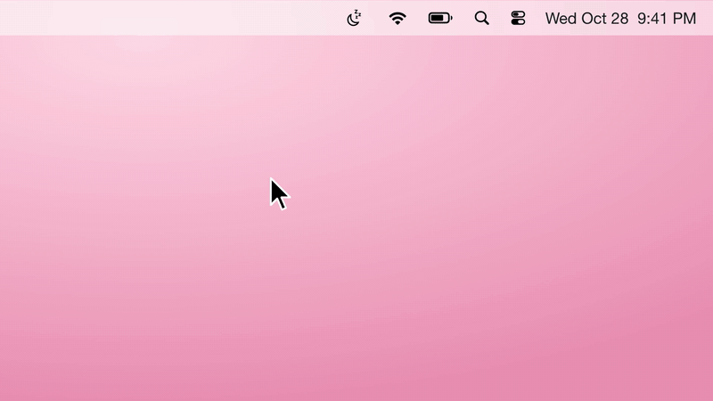

# LidAwake

**English** · [中文](#中文)



Stop walking around with your laptop open so your agent keeps running.

LidAwake is a tiny menu bar switch that keeps your Mac running when you close the lid. Downloads keep downloading, renders keep rendering, your AI agent keeps working. The screen goes dark and everything else carries on.

Click the icon, flip **Keep Running with Lid Closed**, done.

- ☕️ cup = Mac keeps running with the lid closed
- 🌙 moon = normal behavior, closing the lid puts it to sleep

## Install

**One line (easiest, no security warning):**

```bash
curl -fsSL https://raw.githubusercontent.com/jinyibruceli/LidAwake/main/install.sh | bash
```

**Or download:** grab `LidAwake.zip` from [Releases](https://github.com/jinyibruceli/LidAwake/releases/latest), unzip, and open `LidAwake.app`.
The app isn't notarized by Apple, so the first time macOS will block it. Go to **System Settings → Privacy & Security**, scroll down, click **Open Anyway**.

After the first launch it lives in your menu bar for good: it starts at login and comes back on its own if it ever quits.

> Can't see the icon? On MacBooks with a notch, extra icons hide behind it. Hold ⌘ and drag a few other icons out of the menu bar to make room.

## How it works

It flips one built-in macOS setting:

```bash
sudo pmset -a disablesleep 1   # keep running with lid closed
sudo pmset -a disablesleep 0   # back to normal
```

That needs admin rights, so each switch asks for your password or Touch ID. Nothing else is touched, and nothing is sent anywhere. The whole app is one Swift file: [main.swift](main.swift).

⚠️ While it's on, don't put your closed MacBook in a bag. It's still running, so it will get warm and drain the battery.

## Uninstall

Click the icon → **Remove from Menu Bar**, then delete `LidAwake.app`. Removing it does not change the sleep setting, so switch it off first if you want normal sleep back.

## Build from source

```bash
./build.sh   # needs Xcode command line tools; outputs build/LidAwake.app
```

Requires macOS 13 or later. Works on Apple Silicon and Intel.

---

## 中文

从此告别抱着开盖的电脑走路，就为了让 AI 接着干活。

这是一个放在菜单栏的小开关，让 Mac 合上盖子之后继续运行。下载接着下、渲染接着渲、AI 接着干活，只是屏幕黑了。

点图标，勾上 **合盖继续运行**，就这么简单。

- ☕️ 咖啡杯 = 合盖后继续运行
- 🌙 月亮 = 正常，合盖就睡眠

### 安装

**一行命令（最省事，不会弹安全警告）：**

```bash
curl -fsSL https://raw.githubusercontent.com/jinyibruceli/LidAwake/main/install.sh | bash
```

**或者下载：** 在 [Releases](https://github.com/jinyibruceli/LidAwake/releases/latest) 下载 `LidAwake.zip`，解压后打开 `LidAwake.app`。
这个 app 没有经过苹果公证，第一次打开会被拦。去 **系统设置 → 隐私与安全性**，往下翻，点 **仍要打开**。

打开一次之后它就常驻菜单栏：开机自动启动，万一退出了也会自己回来。

> 看不到图标？带刘海的 MacBook 图标多了会被刘海挡住。按住 ⌘ 把几个别的图标拖出菜单栏就能腾出位置。

### 原理

它只改 macOS 自带的一个设置：

```bash
sudo pmset -a disablesleep 1   # 合盖继续运行
sudo pmset -a disablesleep 0   # 恢复正常
```

这个设置需要管理员权限，所以每次切换都会让你输密码或按指纹。别的什么都不碰，也不联网。整个 app 就一个 Swift 文件：[main.swift](main.swift)。

⚠️ 开着的时候别把合上的 MacBook 塞进包里。它还在跑，会发热、会耗电。

### 卸载

点图标 → **从菜单栏移除**，再删掉 `LidAwake.app`。移除不会改回睡眠设置，想恢复正常合盖睡眠的话先把开关关掉。

### 自己编译

```bash
./build.sh   # 需要 Xcode 命令行工具，产物在 build/LidAwake.app
```

需要 macOS 13 或更新，Apple 芯片和 Intel 都能用。

MIT License
